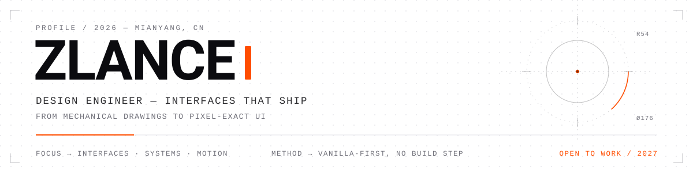
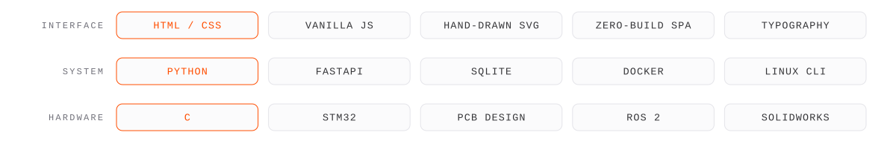
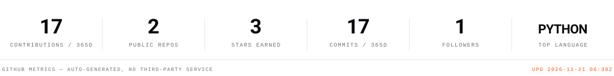

<picture>
  <source media="(prefers-color-scheme: dark)" srcset="assets/hero-dark.svg">
  
</picture>

前端我站「少依赖」那一派：手写 SVG、零构建单页、不上框架也把交互做顺。
硬件那半没丢——STM32、PCB、SolidWorks 的底子还在，所以执行器那边的语言我听得懂。

---

### Selected Work / 作品

**[yinshu](https://github.com/LikeLance/yinshu)** · 银枢 — 可信银行智能体 · `3 ★`
策略判定下沉到服务端执行层：确认卡不复用旧快照，资金步骤幂等，审计写哈希链，
前端是零构建单页。200 个测试，后端覆盖率 84%。
`Python` `FastAPI` `SQLite` `Vanilla JS`

**[exam-paper-forge](https://github.com/LikeLance/exam-paper-forge)** · 期末模拟卷工坊
一句话生成 A/B/C 三套高仿真期末卷，配逐点给分答案册，直接出 LaTeX → PDF。
`Python` `LaTeX` `XeLaTeX`

---

### Stack

<picture>
  <source media="(prefers-color-scheme: dark)" srcset="assets/stack-dark.svg">
  
</picture>

### Numbers

<picture>
  <source media="(prefers-color-scheme: dark)" srcset="assets/stats-dark.svg">
  
</picture>

---

### 我信的三件事

1. 能不用的依赖就不用。少一个依赖，少一次半夜的报错。
2. 界面是给人用的，不是给简历看的。
3. 写代码的时间要花在边界条件上——正常流程本来就会跑通。

---

这个页面没有用任何第三方图床：图形是我自己画 SVG，数字由同仓库的 Action 每天重算一次。
